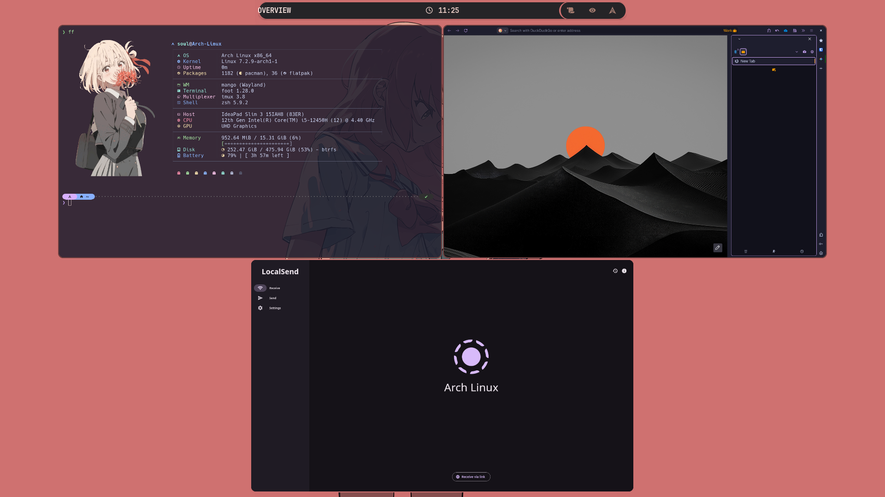
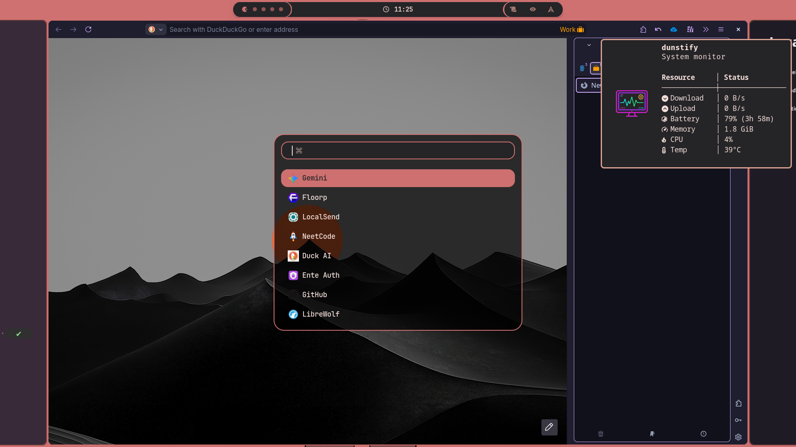

<div align="center">

# 🥭 My-MangoWM

**A sleek, ultra-responsive, dynamic-palette Wayland desktop powered by MangoWM & Wallust.**

[](https://github.com/DreamMaoMao/mango)
[](https://github.com/SoulByte07/mangobar)
[](https://codeberg.org/explosion-mental/wallust)
[](https://codeberg.org/dnkl/foot)
[](https://www.gnu.org/software/bash/)
[](LICENSE)

<p align="center">
  <a href="#-gallery">Screenshots</a> •
  <a href="#-benchmarks--efficiency-flex">Benchmarks & Flex</a> •
  <a href="#-features">Features</a> •
  <a href="#-requirements">Requirements</a> •
  <a href="#-installation">Installation</a> •
  <a href="#-keybindings">Keybindings</a> •
  <a href="#-project-structure">Structure</a> •
  <a href="#-customization">Customization</a>
</p>

</div>

---

## 📸 Gallery

<div align="center">

### Overview & Window Management


<br/>

| Dynamic Rofi Menu | Fastfetch & Terminal Aesthetic |
|:---:|:---:|
|  |  |

</div>

---

## ⚡ Benchmarks & Efficiency (The Flex 💪)

Engineered for extreme responsiveness, thermal efficiency, and maximum battery endurance:

| Metric | Measured Real-World Performance | Details |
| :--- | :---: | :--- |
| **Idle RAM Usage** | **`< 600 MB`** | Complete desktop loaded (MangoWM + MangoBar + Dunst + daemons) |
| **Idle CPU Load** | **`~0%`** | Direct event-driven daemons & C-based system metrics |
| **Battery Life** | **`~7 Hours`** | Tested on a modest **45Wh** battery under normal workflows |

> [!TIP]
> All metrics and background scripts are hyper-optimized to eliminate polling loops, leveraging inotify, native Wayland protocols, and direct kernel syscalls.

---

## ✨ Features

- 🎨 **Dynamic Wallust Palette Theming**: Change wallpapers seamlessly; colors automatically generate and propagate across MangoWM window borders, `mangobar`, `rofi`, and `dunst`.
- ⚡ **Near-Zero Overhead System Monitor**: Includes a custom compiled C system monitor (`scripts/system_monitor.c`) leveraging direct Linux kernel `/proc` and `/sys` interfaces for instant HUD statistics.
- 🚀 **Dropdown Scratchpad Terminal**: Instant toggleable terminal available at `Super + Return` or `Super + Shift + Return` via `foot-dropterm`.
- 📱 **Fluid Touchpad Gestures**: Out-of-the-box 3-finger direction focus, 4-finger tag switching, and swipe into overview.
- 📊 **Dual Bar Layouts**: Switch effortlessly between `classic` and modern `floating-capsule` bar layouts via `scripts/MangobarStyles.sh` (`Super + Alt + B`).
- 🧮 **Rofi Utilities Ecosystem**: Includes quick calculation via `qalc` (`Super + C`), clipboard history manager (`Super + V`), wallpaper gallery selector (`Super + W`), and app switcher.
- 🔒 **Unified Lock & Idle Stack**: Preconfigured with `hypridle` and `hyprlock`, integrating sleep timers and battery statistics.

---

## 📦 Requirements

All required dependencies are neatly documented in [`Asserts/requirements.txt`](Asserts/requirements.txt).

### Core Components
- **Compositor & Bar**: `mango` (or `mango-wm-git`), [`mangobar` (SoulByte07's fork)](https://github.com/SoulByte07/mangobar)
- **Launchers & UI**: `rofi-wayland`, `fuzzel`, `wlogout`
- **Theme & Wallpapers**: `swaybg`, `wallust`, `imagemagick`, `ffmpeg`
- **Daemons**: `dunst`, `wlsunset`, `hypridle`, `hyprlock`
- **Clipboard**: `wl-clipboard`, `wl-clip-persist`, `cliphist`
- **Utilities**: `pamixer`, `playerctl`, `brightnessctl`, `grim`, `slurp`, `satty`, `foot`, `pcmanfm`, `libqalculate` (`qalc`), `fastfetch`, `jq`, `socat`
- **Build Essentials**: `gcc` or `clang`, `make` (to compile `scripts/system_monitor.c`)
- **Fonts & Cursor**: `ttf-jetbrains-mono-nerd`, `Bibata-Modern-Ice` cursor theme

---

## 🛠️ Installation

### 1. Install Dependencies

#### Arch Linux / EndeavourOS
```bash
# Official repository packages
sudo pacman -S --needed \
    foot rofi-wayland fuzzel wlogout swaybg imagemagick ffmpeg \
    dunst wlsunset hypridle hyprlock wl-clipboard cliphist pamixer playerctl \
    brightnessctl grim slurp satty pcmanfm libqalculate fastfetch jq socat \
    base-devel ttf-jetbrains-mono-nerd

# AUR packages (using yay or paru)
yay -S --needed \
    mango-wm-git wallust wl-clip-persist bibata-cursor-theme-bin

# Install SoulByte07's mangobar fork
git clone https://github.com/SoulByte07/mangobar.git /tmp/mangobar
cd /tmp/mangobar && make && sudo make install
```

#### Fedora
```bash
sudo dnf install \
    foot rofi-wayland fuzzel wlogout swaybg ImageMagick ffmpeg \
    dunst wlsunset hypridle hyprlock wl-clipboard pamixer playerctl brightnessctl \
    grim slurp pcmanfm libqalculate fastfetch jq socat gcc make \
    jetbrains-mono-fonts-all
```

---

### 2. Clone the Repository

Clone this configuration directly to your user's `~/.config/mango`:

```bash
git clone https://github.com/SoulByte07/My-MangoWM.git ~/.config/mango
```

> [!NOTE]
> If you already have an existing `~/.config/mango` directory, make sure to back it up first (`mv ~/.config/mango ~/.config/mango.bak`).

---

### 3. Compile System Monitor & Set Permissions

Ensure all helper scripts are executable, and compile the C system monitor binary:

```bash
# Make all scripts executable
chmod +x ~/.config/mango/scripts/*.sh ~/.config/mango/config/autostart.sh

# Compile system monitor binary (optional, scripts will auto-compile if gcc is present)
cd ~/.config/mango/scripts
make
```

---

### 4. Setup Wallpapers Directory

Wallust and the wallpaper selector scan `~/Pictures/wallpapers` by default:

```bash
mkdir -p ~/Pictures/wallpapers
# Add your favorite wallpapers (JPG, PNG, or WEBP) into ~/Pictures/wallpapers
```

---

## ⌨️ Keybindings

MangoWM modifier key is configured as `SUPER` (Windows key).

### 🖥️ Applications & Launchers
| Keybinding | Action |
| :--- | :--- |
| `Super + Return` | Launch `foot` terminal |
| `Super + Shift + Return` | Toggle dropdown scratchpad (`foot-dropterm`) |
| `Super + D` | Open Rofi application launcher |
| `Super + Shift + D` | Open Fuzzel launcher |
| `Super + E` | Open PCManFM file manager |
| `Super + B` | Open default web browser |
| `Super + Tab` | Toggle Window Overview |

### 🛠️ Utilities & Menus
| Keybinding | Action |
| :--- | :--- |
| `Super + C` | Open Rofi Calculator (`qalc`) |
| `Super + V` | Open Clipboard Manager (`cliphist`) |
| `Super + W` | Open Wallpaper Selector |
| `Super + P` | Screenshot Menu (`grim` + `slurp` + `satty`) |
| `Super + M` | Toggle Low-overhead System Monitor |
| `Super + S` | Open Tools Manager |
| `Super + Alt + B` | Cycle `mangobar` styles (Classic / Capsule) |
| `Super + Ctrl + B` | Toggle `mangobar` visibility |
| `Super + Ctrl + R` | Refresh desktop / reapply Wallust theme |

### 🪟 Window Management
| Keybinding | Action |
| :--- | :--- |
| `Super + Q` | Close focused window |
| `Super + Shift + Q` | Force kill active process |
| `Super + F` | Toggle maximize screen |
| `Super + Shift + F` | Toggle fullscreen |
| `Super + Space` | Switch layout (`tile` / `scroller`) |
| `Super + H/J/K/L` | Focus window left / down / up / right |
| `Super + Alt + H/J/K/L` | Move window left / down / up / right |
| `Super + Shift + H/J/K/L` | Resize window horizontally / vertically |
| `Super + [1-9]` | Switch to Tag / Workspace 1 through 9 |
| `Super + Shift + [1-9]` | Move window to Tag 1 through 9 |
| `Super + Left / Right` | Relative tag navigation |

### ⚡ System & Power
| Keybinding | Action |
| :--- | :--- |
| `Super + R` | Reload MangoWM configuration |
| `Super + Shift + R` | Reload full environment & restart daemons |
| `Super + Ctrl + L` | Lock screen (`hyprlock`) |
| `Super + Ctrl + P` | Logout / Power menu (`wlogout`) |
| `XF86AudioRaiseVolume` | Volume Up |
| `XF86AudioLowerVolume` | Volume Down |
| `XF86AudioMute` | Mute Audio |
| `XF86MonBrightnessUp/Down` | Display Brightness Up / Down |

---

## 📂 Project Structure

```text
~/.config/mango/
├── config.conf               # Top-level configuration entry point
├── config/                   # Modular configuration files
│   ├── autostart.sh          # Daemons, night light, bar & background services
│   ├── bind.conf             # Keybindings, mousebinds, and gestures
│   ├── colors.conf           # Dynamic compositor borders (generated by Wallust)
│   ├── config.conf           # Layouts, compositor options, trackpad & mouse
│   ├── env.conf              # Environment variables & hardware acceleration
│   ├── hypridle.conf         # Idle management timeouts
│   ├── hyprlock.conf         # Lockscreen aesthetics & battery status
│   ├── monitor.conf          # Display output resolutions & refresh rates
│   ├── rule.conf             # Window rules, float assignments & tags
│   └── animations/           # Swappable animation presets
├── mangobar/                 # Status bar configuration
│   ├── config.jsonc          # Bar modules configuration
│   ├── style.css             # Bar styling
│   └── themes/               # Classic & floating-capsule themes
├── rofi/                     # Rofi configs, app menus, calculators, themes
├── wallust/                  # Wallust template engine for dynamic colors
├── wlogout/                  # Wlogout power menu layout & styling
├── scripts/                  # Shell & C automation scripts
│   ├── system_monitor.c      # Ultra-fast C system monitor engine
│   ├── WallpaperDaemon.sh    # Wallpaper manager (swaybg + wallust)
│   ├── MangobarStyles.sh     # Bar theme switcher
│   └── ...                   # Volume, Brightness, Screenshot, etc.
└── Asserts/
    ├── requirements.txt      # Dependency specification file
    └── ScreenShots/          # Showcase images for documentation
```

---

## 🎨 Customization

### Hardware Video Acceleration
Edit [`config/env.conf`](config/env.conf) to match your GPU hardware:
- **Intel Iris / Xe**: `env=LIBVA_DRIVER_NAME,iHD` & `env=MESA_LOADER_DRIVER_OVERRIDE,iris`
- **AMD Radeon**: `env=LIBVA_DRIVER_NAME,radeonsi` & `env=VDPAU_DRIVER,radeonsi`
- **NVIDIA**: Refer to Wayland NVIDIA documentation (`nvidia-drm.modeset=1`).

### Monitor Configuration
Edit [`config/monitor.conf`](config/monitor.conf) to adjust monitor resolution, refresh rate, and positioning:
```conf
# monitor=NAME,WIDTHxHEIGHT@REFRESH,POS_X,POS_Y,SCALE
monitor=eDP-1,1920x1080@60,0,0,1
```

### Changing Wallpapers
Press **`Super + W`** to open the graphical wallpaper selector, or run:
```bash
bash ~/.config/mango/scripts/WallpaperDaemon.sh --random
```
Wallust will automatically recalculate colors, update borders, reload `mangobar`, and notify `dunst`.

---

## 🤝 Contributing & License

Contributions, suggestions, and improvements are always welcome!
Feel free to open an issue or submit a pull request.

Distributed under the [GNU GPLv3](LICENSE) License.
